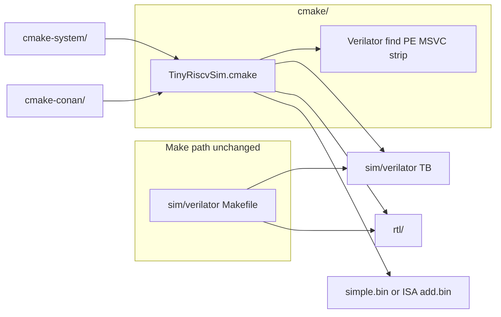

# CMake dual-tree (optional)

Pattern: [weiwan-gmail/rtl-learning-plan](https://github.com/weiwan-gmail/rtl-learning-plan) `cmake-system/` + `cmake-conan/`.

Does **not** replace Make. `make -C sim/verilator sim`, `python3 sim/sim_new_nowave.py …`, and iverilog stay as they are. CMake only **reuses** `sim/verilator/tb_verilator.*` and the RTL listed in `sim/verilator/rtl.f` (relative paths; no CPU rewrite).



`cmake-system` uses a machine-installed Verilator. `cmake-conan` is the same sim, with a local Conan 2 recipe that **packages** the kit (withlimon PE on Windows, `apt` kit on Linux) — it does not rebuild Verilator from source.

## Commands (Linux)

```bash
# system Verilator
cmake -S cmake-system -B build-system -DCMAKE_BUILD_TYPE=Release
cmake --build build-system --target sim
cmake --build build-system --target sim-fail
ctest --test-dir build-system --output-on-failure

# Conan 2 (optional; pip install conan==2.34.0)
export PATH="$HOME/.local/bin:$PATH"
conan profile detect --force
cmake -S cmake-conan -B build-conan -DCMAKE_BUILD_TYPE=Release
cmake --build build-conan --target sim
```

`--target sim` runs the same C++ TB as `make -C sim/verilator sim` and expects **`TEST_PASS`** / exit 0.

## Firmware

| Situation | `inst.data` source |
|-----------|--------------------|
| RISC-V GCC + GNU make on PATH | `make -C tests/example/simple` → `simple.bin` (same as LEARNING.md) |
| `simple.bin` already built | use it |
| no toolchain | committed `tests/isa/generated/rv32ui-p-add.bin` (CMake **WARNING**, still `TEST_PASS`) |

The Verilator **model still compiles** if the RISC-V toolchain is missing. Install `gcc-riscv64-unknown-elf` (or xpack `riscv-none-elf-gcc`) to match the Make smoke exactly.

`$readmemh("inst.data")` is unchanged; CMake generates `inst.data` in the build directory and runs the TB there.

## Windows (PC2023 PASS)

Use [withlimon/verilator-windows](https://github.com/withlimon/verilator-windows) **`verilator_bin.exe`** (PE / MZ). Never the extensionless Perl `verilator`. Copy-paste: [`cmake-system/WINDOWS.md`](cmake-system/WINDOWS.md).

Both trees **PASS** on worker PC2023 at `develop` **`4dd5b21`**, engine `C:\msys64\mingw64\bin\verilator_bin.exe`:

| Tree | Result |
|------|--------|
| `cmake-system` | PASS (withlimon PE under MSYS2 MinGW64) |
| `cmake-conan` | `build_sim.ps1` EXIT 0; ctest 3/3 (`tinyriscv_fw_setup`, `sim_tinyriscv`, `sim-fail`). Conan **2.34.0**. |

Firmware without RISC-V GCC is a **warning** (fallback `tests/isa/generated/rv32ui-p-add.bin`), not a fail. cmake-conan may also print non-fatal CMake-Conan “C compiler is not defined” (`project()` is `LANGUAGES CXX`). Evidence: [`cmake-system/WINDOWS_PASS_EVIDENCE.md`](cmake-system/WINDOWS_PASS_EVIDENCE.md), [`cmake-conan/WINDOWS_PASS_EVIDENCE.md`](cmake-conan/WINDOWS_PASS_EVIDENCE.md). Linux VM: [`cmake-system/PASS_EVIDENCE.md`](cmake-system/PASS_EVIDENCE.md).

## Layout

| Path | Role |
|------|------|
| `cmake/TinyRiscvSim.cmake` | Verilator find, PE check, MSVC `-fcoroutines*` strip, TB + firmware |
| `cmake/verilator-config.fallback.cmake` | withlimon kits have no `verilator-config.cmake` |
| `cmake/PreferUnixGcc.cmake` | `project()` 前优先 g++ |
| `cmake/fail-harness/` | `sim-fail` inject-and-catch (not CPU RTL) |
| `cmake-system/` | thin wrapper, system Verilator |
| `cmake-conan/` | thin wrapper + local `verilator/5.052` recipe |
