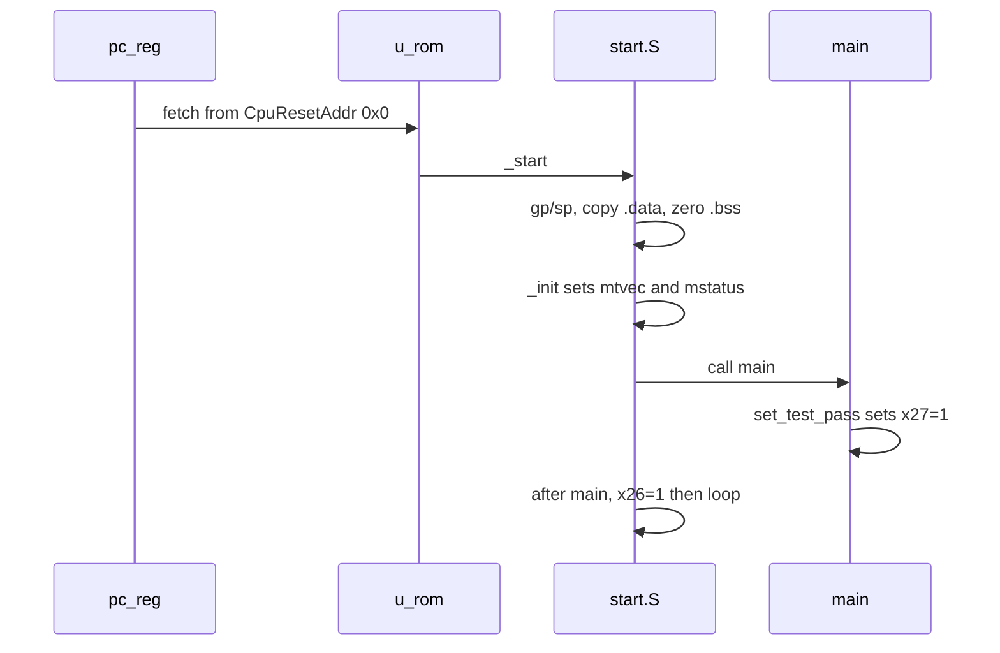

# tinyriscv tutorial (English summary)

Full walkthrough: **[TUTORIAL_zh.md](TUTORIAL_zh.md)** (Chinese).  
Proven logs: **[logs/](logs/)**. Command index: **[../LEARNING.md](../LEARNING.md)**.

## What tinyriscv is

A small **RV32IM** 3-stage (IF / ID / EX) Verilog core aimed at Cortex-M3-class SoCs: RIB bus, ROM/RAM, UART, GPIO, SPI, timer/CLINT, JTAG, optional FreeRTOS. Reset PC is `0x0`. C programs are linked with flash at `0x00000000` and RAM at `0x10000000` (`tests/example/link.lds`).

This repository is `weiwan-gmail/tinyriscv` (fork of `liangkangnan/tinyriscv`). Work here is on **develop**; the Verilator harness targets **this** RTL, not the upstream Gitee `verilator` branch (that branch replaces the bus/JTAG/SoC).

## Repo map

| Path | Role |
|------|------|
| `rtl/core/` | CPU pipeline, RIB, CSRs, CLINT |
| `rtl/perips/` | rom, ram, uart, gpio, spi, timer |
| `rtl/soc/tinyriscv_soc_top.v` | SoC; `over`/`succ` mirror `~x26`/`~x27` |
| `rtl/debug/` | JTAG + UART bootloader |
| `tb/tinyriscv_soc_tb.v` | iverilog testbench (`$readmemh("inst.data", ...)`) |
| `sim/` | Python + iverilog flow |
| `sim/verilator/` | C++ harness (`tb_verilator.v` + `tb_verilator.cpp`) |
| `cmake-system/` / `cmake-conan/` | Optional CMake dual-tree wrapping the same TB ([CMAKE.md](../CMAKE.md)) |
| `tests/example/` | C examples (`simple`, `uart_tx`, …) |
| `tests/isa/` | older ISA `.bin` tests |
| `tools/BinToMem_CLI.py` | little-endian `.bin` → hex `inst.data` |

## How firmware boots



1. `pc_reg` starts at `CpuResetAddr` (`32'h0`).
2. Fetch comes from RIB master1 → ROM slave0. `$readmemh` / Verilator preload fills `rom._rom`.
3. `start.S` (`-DSIMULATION`) clears `x26`/`x27`, copies `.data` from flash LMA into RAM, zeros BSS, calls `_init` then `main`.
4. `main` in `simple` computes `sum==7550` and calls `set_test_pass()` (`li x27, 1`) or `set_test_fail()`.
5. Returning from `main` executes `li x26, 1`. The TB waits for `x26==1` and checks `x27`.

## Install tools

```bash
sudo apt-get install -y iverilog verilator gcc-riscv64-unknown-elf python3 build-essential
```

Verified here: Icarus 12.0, Verilator 5.020, `riscv64-unknown-elf-gcc` 13.2.0.

**`TOOLCHAIN_PREFIX`**: compiler prefix including the trailing `-`. `tests/example/common.mk` auto-detects `riscv64-unknown-elf-`, `riscv-none-elf-` (xpack), `riscv32-unknown-elf-`, `riscv-none-embed-`, or the old Windows `tools/gnu-mcu-eclipse-...` path. GCC 10+ needs `rv32im_zicsr` for CSR in `start.S`/`init.c`; the Makefile appends `_zicsr` when the assembler asks for it. Ubuntu’s GCC package has **no newlib**, so examples link with `-nostdlib`.

## Build C → iverilog → Verilator

```bash
make -C tests/example/simple          # -> simple.bin
python3 sim/sim_new_nowave.py tests/example/simple/simple.bin inst.data
# expect: TEST_PASS
make -C sim/verilator sim
# expect: TEST_PASS  and  echo $?  ->  0
```

Optional CMake (Make path unchanged): see [CMAKE.md](../CMAKE.md).

UART hello (`tests/example/uart_tx`; there is no `hello/` directory):

```bash
make -C tests/example/uart_tx
make -C sim/verilator PROG=../../tests/example/uart_tx/uart_tx.bin EXPECT_UART=hello sim
```

## PASS / FAIL

Same protocol as the original TB: **`x26=1` done, `x27=1` pass**. SoC `over`/`succ` are inverted. Iverilog prints the PASS/FAIL ASCII art. Verilator prints the same banner and returns 0 / 1 / 2 (pass / fail / timeout).

Logs from a real run (cycles differ by a handful of ns between iverilog and Verilator):

- Iverilog simple: `TEST_PASS` at ~57.89 µs — [logs/03-iverilog-simple.txt](logs/03-iverilog-simple.txt)
- Verilator simple: `TEST_PASS` `cycles=2888` — [logs/04-verilator-simple.txt](logs/04-verilator-simple.txt)
- UART: Verilator prints `hello world` then `UART_EXPECT_PASS` — [logs/05-verilator-uart_tx.txt](logs/05-verilator-uart_tx.txt)

## Next: picorv32 and FemtoRV

- **picorv32**: one-file-ish RV32I/M Verilog, classic `mem_*` interface. Compare with tinyriscv’s RIB masters (IF vs EX) and the 3-stage pipeline.
- **FemtoRV**: teaching SoCs (QUARK → ELEPHANT). Good second project for memory map + UART after this `simple` / `uart_tx` loop.
- Stay on **this** tree until `simple` is green on both sims; then read `rtl/core/{if_id,id,id_ex,ex,ctrl}.v`. Upstream `verilator` branch is optional later (GDB/JTAG), not required for this tutorial.
