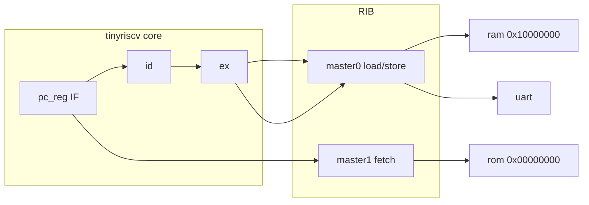
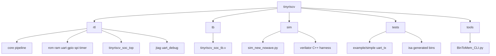
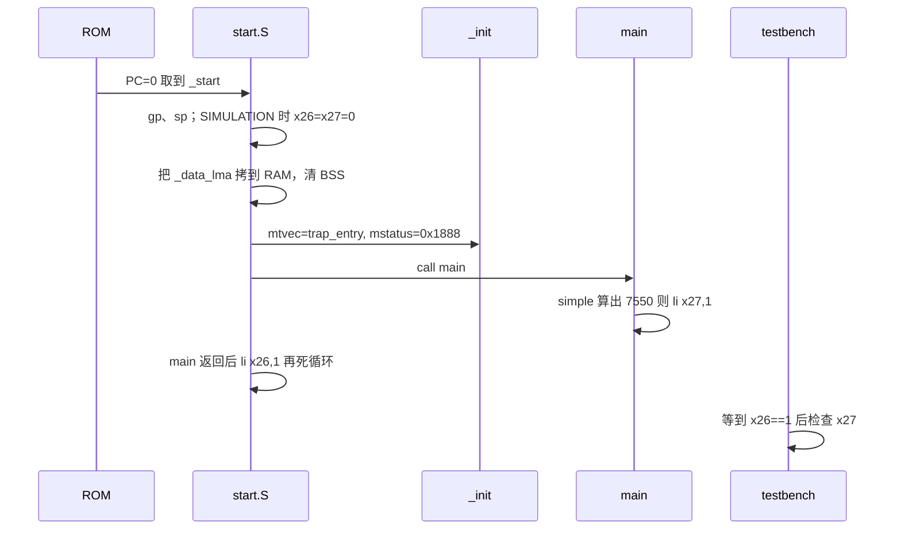

# tinyriscv 学习教程（中文主文档）

面向 Wei 的完整上手说明：从仓库结构、固件如何从地址 0 启动，到用 **C 交叉编译 → iverilog 仿真 → Verilator C++ 同镜像仿真** 跑通 `simple`（以及 UART 版 “hello world”）。

英文摘要：[TUTORIAL.md](TUTORIAL.md)  
命令速查：[../LEARNING.md](../LEARNING.md)  
本教程里每一条关键命令都在 [logs/](logs/) 里有**真实终端输出**，不是口头推演。

> 工作分支：`weiwan-gmail/tinyriscv` 的 **develop**（上游为 `liangkangnan/tinyriscv`）。  
> 本教程**不改 CPU 流水线 RTL**，只补了可移植工具链、iverilog 脚本的 Python3 修复，以及 `sim/verilator/` 下的教学用 C++ testbench。  
> Gitee 上游另有 `verilator` 分支（OBI 总线、重写 JTAG、OpenOCD），和本仓库 SoC **不是同一套 RTL**，不要混用 Makefile。

---

## 1. tinyriscv 是什么

tinyriscv 是一个用 Verilog 写的 **RV32IM** 单核，设计目标对标 ARM Cortex-M3 一类的小型 MCU：

- 三级流水线：取指 (IF) → 译码 (ID) → 执行 (EX)
- 内部总线 **RIB**（RISC-V Internal Bus）：多个 master / slave
- 外设：ROM、RAM、UART、GPIO、SPI、定时器（CLINT 中断）
- 调试：JTAG；也支持串口烧写
- 软件：可跑 C（本教程）、ISA 兼容性测试、FreeRTOS、CoreMark

复位后 PC 从 **`32'h0`** 开始（`rtl/core/defines.v` 里的 `CpuResetAddr`）。对学习者来说，它比 picorv32 / FemtoRV 更“MCU 化”：有明确的外设地址空间和 `start.S`。



地址空间（每段 256MB，详见根 README 配图）：ROM 从 `0x00000000` 取指令；RAM 从 `0x10000000` 放 `.data` / `.bss` / 栈。C 链接脚本是 `tests/example/link.lds`（flash 16K + ram 16K）。

---

## 2. 仓库地图



| 路径 | 干什么 |
|------|--------|
| `rtl/core/` | CPU：`tinyriscv.v` 顶层，`pc_reg` / `if_id` / `id` / `id_ex` / `ex` / `ctrl` / `regs` / `csr_reg` / `div` / `clint` / `rib` |
| `rtl/perips/rom.v` | 指令存储器，仿真时被 `$readmemh` 灌入 `_rom[]` |
| `rtl/soc/tinyriscv_soc_top.v` | SoC；输出 `over=~x26`、`succ=~x27` |
| `tb/tinyriscv_soc_tb.v` | iverilog testbench：等 `x26==1`，再看 `x27` |
| `sim/*.py` | 把 `.bin` → `inst.data`，调用 iverilog / vvp |
| `sim/verilator/` | **本 fork 新增**：C++ 时钟驱动 + 同样的 `inst.data` |
| `tests/example/simple` | 加减乘除，算完 `sum==7550` 则 PASS |
| `tests/example/uart_tx` | 打印 `hello world`（仓库里没有独立的 `hello/` 目录） |
| `tests/example/start.S` | 所有 C 例程共用启动代码 |
| `tests/example/common.mk` | 交叉编译；**`TOOLCHAIN_PREFIX`** 在这里解析 |
| `tools/BinToMem_CLI.py` | 小端 `.bin` 按 32-bit 字写成 hex，一行一个字 |

本仓库 **没有** 把 GNU 工具链打进 `tools/`（上游 README 里的百度网盘路径）。请用发行版或 xpack，见第 4 节。

---

## 3. CPU 如何“启动”一段 C 固件

仿真和 FPGA 走同一条软件路径，差别只在 ROM 里的内容从哪来。

### 3.1 硬件侧

1. `rst` 低有效（`RstEnable = 1'b0`）。
2. `pc_reg` 在复位时把 PC 置为 `0x0`。
3. 取指走 RIB master1，只读；RIB 把 `0x00000000` 附近的访问译到 **slave0 = ROM**。
4. iverilog / Verilator 在仿真 0 时刻执行：
   `$readmemh("inst.data", tinyriscv_soc_top.u_rom._rom);`
5. 之后每个时钟 ROM 按 `addr[31:2]` 取出一条 32-bit 指令。

`inst.data` 不是 ELF。`BinToMem_CLI.py` 读 `simple.bin`（objcopy `-O binary` 的纯镜像，从链接地址 0 开始），每 4 字节写成一行 8 位 hex（高字节在前，供 `$readmemh` 使用）。

### 3.2 软件侧（`start.S` + `init.c` + `main`）



`simple/main.c` 做两段循环再乘除：期望 `sum == 7550`。通过则 `set_test_pass()` 展开成 `li x27, 0x01`（见 `include/utils.h`，仅当 `-DSIMULATION`）。

**务必带着 `-DSIMULATION` 编译**（`simple/Makefile` 已打开）。否则 `start.S` 不会写 `x26`，testbench 会一直等到超时。

SoC 还把这对寄存器翻转到管脚上，方便 FPGA 灯和 Verilator 探口：

```verilog
over <= ~u_tinyriscv.u_regs.regs[26];  // 1=未结束, 0=结束
succ <= ~u_tinyriscv.u_regs.regs[27];  // 1=失败, 0=成功
```

---

## 4. 安装工具

在 Ubuntu / Debian（本云环境实测：Icarus **12.0**，Verilator **5.020**，GCC **13.2.0**）：

```bash
sudo apt-get install -y iverilog verilator gcc-riscv64-unknown-elf python3 build-essential
iverilog -V | head -n 1
verilator --version
riscv64-unknown-elf-gcc --version | head -n 1
```

对应 log：[logs/01-inspect.txt](logs/01-inspect.txt)

### 4.1 `TOOLCHAIN_PREFIX` 是什么

它是 **RISC-V GCC 的前缀**（含末尾的 `-`，也可以含目录）：

| 来源 | `TOOLCHAIN_PREFIX` |
|------|--------------------|
| Ubuntu 包 `gcc-riscv64-unknown-elf` | `riscv64-unknown-elf-` |
| xpack `@xpack-dev-tools/riscv-none-elf-gcc` | `.../bin/riscv-none-elf-` |
| 上游旧 Windows 包 `riscv-none-embed-gcc` | `tools/gnu-mcu-eclipse-.../bin/riscv-none-embed-` |

`tests/example/common.mk` 会按 PATH 自动探测；也可显式传入：

```bash
make -C tests/example/simple TOOLCHAIN_PREFIX=riscv64-unknown-elf-
make -C tests/example/simple toolchain-info
```

额外两点（现代工具链）：

1. **Zicsr**：GCC 10+ 把 CSR 从 `I` 里拆出去了。`start.S` / `init.c` 用了 `csrr`/`csrw`，所以探测失败时 Makefile 会自动把 `rv32im` 变成 `rv32im_zicsr`。
2. **没有 newlib**：Ubuntu 这个 GCC 包没有 `-lc`/`-lgloss`。例程自带 `start.S`，用 `-nostdlib` 链接。完整 xpack/SiFive 工具链同样适用。

不要再依赖 README 里失效的百度网盘路径。

---

## 5. 编译最简单的 C：`tests/example/simple`

```bash
make -C tests/example/simple clean
make -C tests/example/simple
ls -l tests/example/simple/simple.bin
```

成功时会看到类似：

```
Using TOOLCHAIN_PREFIX=riscv64-unknown-elf- RISCV_ARCH=rv32im_zicsr
riscv64-unknown-elf-objcopy -O binary simple simple.bin
```

产物：

- `simple`：ELF（可 `objdump`）
- `simple.bin`：从地址 0 开始的裸镜像，送给仿真
- `simple.dump`：反汇编；`<_start>:` 应在 `00000000`

完整输出：[logs/02-build-simple.txt](logs/02-build-simple.txt)

`uart_tx` 同样：

```bash
make -C tests/example/uart_tx
```

---

## 6. iverilog + Python 仿真

在仓库根目录或 `sim/` 下都可以（脚本会 `chdir` 到 `sim/`）：

```bash
python3 sim/sim_new_nowave.py tests/example/simple/simple.bin inst.data
```

脚本做三件事：

1. `tools/BinToMem_CLI.py` 生成 `inst.data`
2. `compile_rtl.py` 调用 `iverilog` 得到 `out.vvp`（默认 `-DNO_WAVE`，不写巨大 VCD）
3. `vvp out.vvp` 跑 `tb/tinyriscv_soc_tb.v`

**PASS 长这样**（真实 log：[logs/03-iverilog-simple.txt](logs/03-iverilog-simple.txt)）：

```
test running...
WARNING: ... $readmemh(inst.data): Not enough words ... [0:4095].
~~~~~~~~~~~~~~~~~~~ TEST_PASS ~~~~~~~~~~~~~~~~~~~
~~~~~~~~~ #####     ##     ####    #### ~~~~~~~~~
...
```

`$readmemh` 的 WARNING 正常：ROM 深度 4096 字，`simple.bin` 只有几百字节。

看波形（可选）：

```bash
DUMP_WAVE=1 python3 sim_new_nowave.py ../tests/example/simple/simple.bin inst.data
gtkwave tinyriscv_soc_tb.vcd
```

ISA 冒烟（需要 `tests/isa/generated/*.bin`）：

```bash
python3 test_all_isa.py
```

---

## 7. Verilator + C++ 同镜像仿真

文件都在 `sim/verilator/`，**没有改 CPU**：

| 文件 | 作用 |
|------|------|
| `tb_verilator.v` | 包一层 SoC，绑掉 JTAG/SPI/GPIO，`$readmemh` 灌 ROM |
| `tb_verilator.cpp` | 产生 50 MHz 时钟、释放复位、等 `over==0`、看 `succ`；顺带解 UART |
| `Makefile` | 先编 C 固件，再 `BinToMem`，再 `verilator --cc --exe --build` |

```bash
make -C sim/verilator sim
```

可选 CMake 双树（**不改** 上面这条 Make；复用同一 TB）：[CMAKE.md](../CMAKE.md)。Windows（PC2023，withlimon `verilator_bin.exe`）：[cmake-system/WINDOWS.md](../cmake-system/WINDOWS.md)。

**PASS 长这样**（[logs/04-verilator-simple.txt](logs/04-verilator-simple.txt)）：

```
test running (Verilator, max_cycles=2000000)...
~~~~~~~~~~~~~~~~~~~ TEST_PASS ~~~~~~~~~~~~~~~~~~~
...
cycles=2888 sim_time=58260 ns
```

和 iverilog 的结束时刻（约 57.89 µs）只差几个时钟，说明两边跑的是**同一份** `simple.bin`。

进程返回值：`0` PASS，`1` FAIL / UART 不匹配，`2` 超时。

UART “hello world”（[logs/05-verilator-uart_tx.txt](logs/05-verilator-uart_tx.txt)）：

```bash
make -C tests/example/uart_tx
make -C sim/verilator PROG=../../tests/example/uart_tx/uart_tx.bin EXPECT_UART=hello sim
```

会在 stdout 上看到 CPU 用 115200 8N1 发出来的 `hello world`，然后 `UART_EXPECT_PASS`。iverilog 侧同样有 `TEST_PASS`（[logs/05-iverilog-uart_tx.txt](logs/05-iverilog-uart_tx.txt)），只是原 TB 不解串口字符。

---

## 8. 怎么读 PASS / FAIL

| 现象 | 含义 |
|------|------|
| 大字 `TEST_PASS` | `x26==1` 且 `x27==1` |
| 大字 `TEST_FAIL` / `fail testnum = N` | 程序结束但 `x27!=1`；ISA 测试里 `x3` 是失败编号 |
| `Time Out.` | iverilog 5 ms 内 `x26` 一直不是 1：常见原因是没加 `-DSIMULATION`、bin 没灌进 ROM、程序卡死 |
| `TEST_TIMEOUT` | Verilator 达到 `+max-cycles=`（默认 200 万周期） |
| `UART_EXPECT_PASS` | C++ 从 `uart_tx_pin` 采样到了期望子串 |

调试思路：

1. `simple.dump` 里确认 `_start` 在 `0x0`，`main` 里有 `li s11,1`（s11 即 x27）。
2. 确认仿真工作目录里有刚生成的 `inst.data`。
3. 需要波形时用 `DUMP_WAVE=1`（iverilog）或 `make -C sim/verilator TRACE=1`（需改编译选项后重编）。

---

## 9. 下一步：读核，然后看 picorv32 / FemtoRV

建议顺序（都先保证本仓库 `simple` 双仿真为绿）：

1. **读自己的流水线**：`rtl/core/tinyriscv.v` 连线 → `if_id.v` / `id.v` / `ex.v` / `ctrl.v`。对照一份 `simple.dump`，在 gtkwave 里看 `pc_o` 和指令。
2. **RIB**：为什么取指是 master1、访存是 master0；`rib.v` 的优先级与 hold。
3. **picorv32**（Claire Wolf）：同样是小 RV32 Verilog，但对外是一组 `mem_valid/ready/addr/wdata`。对比“总线协议”比对比流水线级数更有收获。
4. **FemtoRV**：教学向 SoC，QUARK 极简、ELEPHANT 较完整。适合在 tinyriscv 的 UART+链接脚本之后，换一家的 `start.S` / 地址图。
5. 若以后要 GDB/OpenOCD：再单独 clone 上游 Gitee **`verilator` 分支**，不要覆盖本 fork 的 `rtl/`。

---

## 10. 命令清单（可复制）

```bash
# 工具
sudo apt-get install -y iverilog verilator gcc-riscv64-unknown-elf python3 build-essential

# C
make -C tests/example/simple TOOLCHAIN_PREFIX=riscv64-unknown-elf-

# iverilog
cd sim
python3 sim_new_nowave.py ../tests/example/simple/simple.bin inst.data
# → TEST_PASS

# Verilator
make -C sim/verilator sim
# → TEST_PASS，exit 0

# hello world UART
make -C tests/example/uart_tx
python3 sim/sim_new_nowave.py tests/example/uart_tx/uart_tx.bin inst.data
make -C sim/verilator PROG=../../tests/example/uart_tx/uart_tx.bin EXPECT_UART=hello sim
```

日志目录与本节命令一一对应：`docs/logs/01` … `05`。
